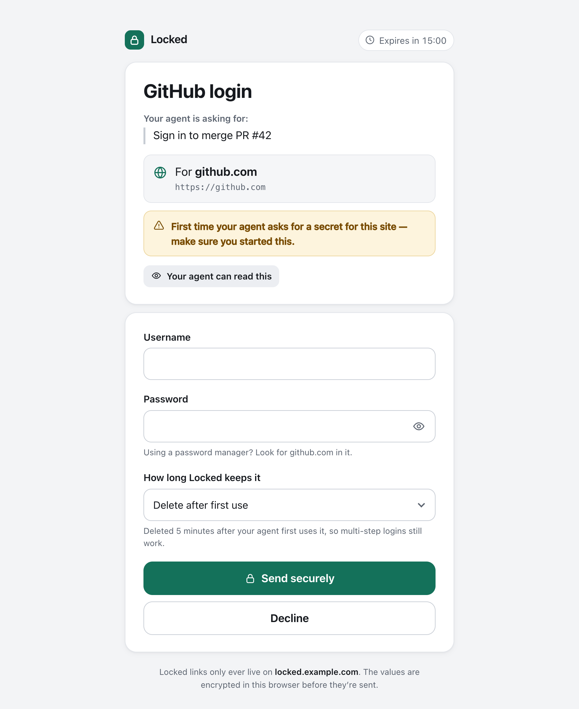
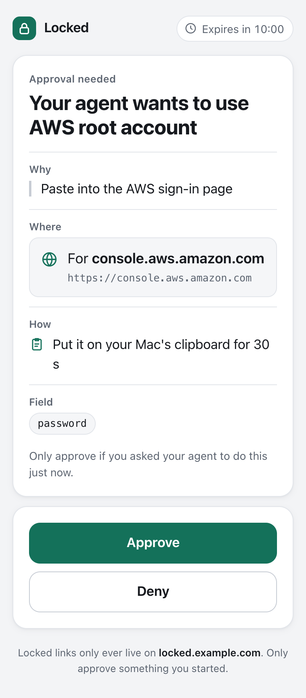
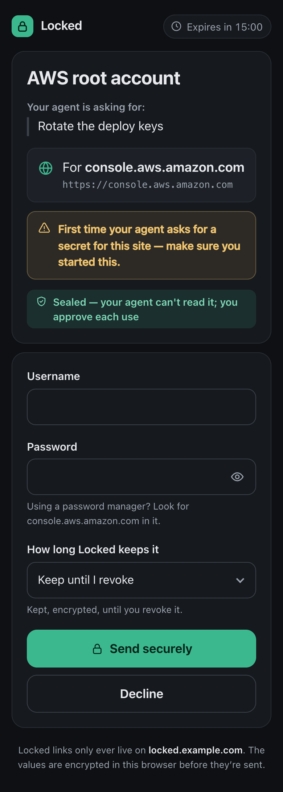
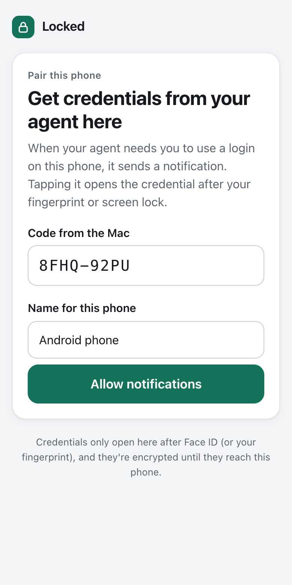
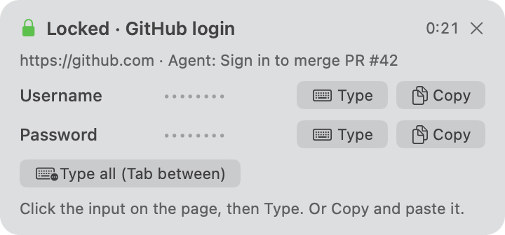

# Locked

Your AI agent needs your GitHub password. You shouldn't have to paste it into the chat.

Locked gives your agent a link instead. You open it, type the secret into a short form, and the agent uses it to fill the login page or run a command. The value stays out of the transcript.

It runs on your own machine, with no account and no hosted service. It works with Claude Code, Codex and any agent that can run a shell command.

<p align="center">
  
</p>

## Install

You need [Bun](https://bun.sh) (`curl -fsSL https://bun.sh/install | bash`).

```bash
bun install -g github:BigSmallXYZ/locked
locked setup
```

`locked setup` does the rest and is safe to run again:

- creates `~/.locked` and a master key in the macOS Keychain
- picks a tunnel, so links open from your phone or anywhere else (it installs `cloudflared` with Homebrew if you have no tunnel tool)
- installs the skill for each agent it finds
- starts the server

After that the server starts by itself whenever the CLI needs it.

### Or let your agent do it

Paste this into Claude Code, Codex or another agent:

```text
Set up Locked for me by following
https://raw.githubusercontent.com/BigSmallXYZ/locked/main/docs/agent-setup.md
```

## Using it

Ask your agent to do something that needs a login. It takes it from there:

```console
$ locked request --label "GitHub login" --site github.com --login --reason "Sign in to merge PR #42"
Created lk_9annq4xkpv (normal, for https://github.com); the link expires in 15 min.
Send the user this link:
  https://pottery-shelf-insulin-herald.trycloudflare.com/r/Y2QkDzXO…
Then run: locked wait lk_9annq4xkpv
```

You open the link and fill the form. The agent then uses the secret in whichever of these fits:

| | How it works |
|---|---|
| **Fill a web login** | `locked inject` gives the agent a one-time snippet that fills the page's inputs and reports what it filled, never the values |
| **Run a command** | `locked exec` passes it as an environment variable and redacts it from the output |
| **Type it for you** | `locked panel` shows a small panel on your Mac. Click into any input, in any app, then click Type |
| **Send it to your phone** | `locked phone send` puts a notification on your phone. Unlock with Face ID, then Copy or Show |

For bank logins, primary email and keys that can spend money, the agent should ask with `--level sealed`. The agent can't read a sealed secret, and every use needs your approval.

<table>
  <tr>
    <td width="33%"></td>
    <td width="33%"></td>
    <td width="33%"></td>
  </tr>
  <tr>
    <td align="center">Approve each use of a sealed secret</td>
    <td align="center">Fill the form from your phone</td>
    <td align="center">Pair a phone for Face ID unlock</td>
  </tr>
</table>

<p align="center">
  <br>
  The Mac panel types into any app, including terminal prompts.
</p>

## Tunnels

The fill page has to be reachable from wherever you open the link. `locked setup` chooses for you, and you can switch at any time:

```bash
locked tunnel use quick                                  # cloudflared, no account, new address on each restart
locked tunnel use ngrok --domain calm-otter.ngrok-free.app   # free account, stable address
locked tunnel use tunnelmole                             # open source, new address on each restart
locked tunnel use cloudflare --hostname locked.example.com   # your own domain on Cloudflare
locked tunnel use url https://locked.example.com         # any tunnel or proxy you already run
locked tunnel use none                                   # links only open on this machine
locked restart
```

Phone pairing needs an address that stays the same, so use ngrok or your own domain for that. Whichever you pick, only the form's port is exposed. The API that reads secrets stays on localhost. [Choosing a tunnel](docs/tunnels.md) compares them.

## Docs

- [Usage](docs/usage.md): every command, sealed secrets, the panel, phones
- [How it works](docs/how-it-works.md): the moving parts and what happens to a secret
- [Tunnels](docs/tunnels.md): choosing one, and what each can see
- [Security](docs/security.md): what Locked protects against, and what it doesn't
- [Agent setup](docs/agent-setup.md): instructions written for agents

## Platforms

macOS gets everything. On Linux the master key lives in a file (`~/.locked/master.key`, mode 0600), and the Mac panel, Touch ID and clipboard commands aren't available. Requests, autofill, `exec`, approvals and phones work the same.

## Development

```bash
git clone https://github.com/BigSmallXYZ/locked && cd locked
bun install
bun test            # unit and HTTP tests (clipboard tests run only on macOS)
bun run typecheck
bun run fixtures    # local login pages on :7420 for trying the autofill snippet
```

## License

[MIT](LICENSE)
