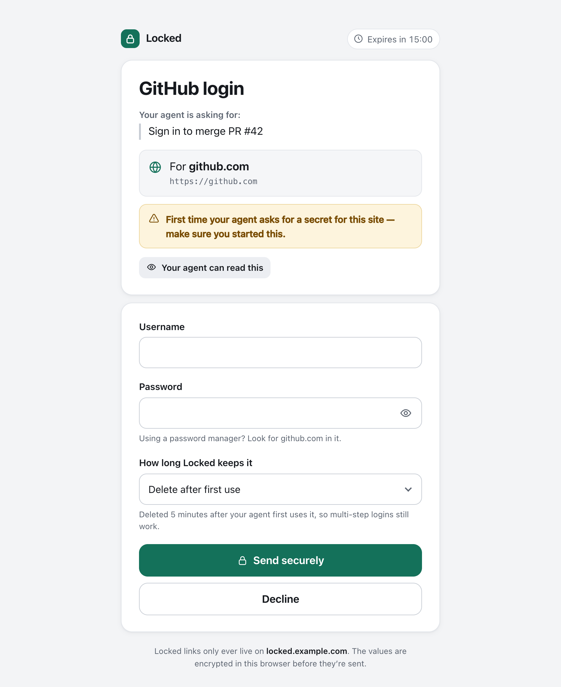
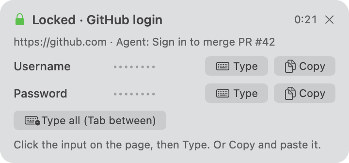

Ok, if you are using Claude you know this moment. It's doing great and then it reaches a login page and just stops.

So you give it the password and it denies. You try again and it keeps denying. It doesn't want your password on the chat, and I get it, but now the task is stuck and you have to do that part yourself.

So I created Locked. Instead of you pasting the secret, the agent sends you a link. You open it, type the secret in a small form and the agent uses it. The value stays out of the chat.

It runs on your machine, so there is no account and no hosted service.

To install it you just need [Bun](https://bun.sh) and then run this

```bash
bun install -g github:BigSmallXYZ/locked
locked setup
```

That's it. `locked setup` picks a tunnel, installs the skill for the agents it finds and starts the server. If you don't want to do that either you can ask your agent to do it, there is a [guide written for agents](https://github.com/BigSmallXYZ/locked/blob/main/docs/agent-setup.md).

Now when the agent needs a login it runs this

```bash
locked request --label "GitHub login" --site github.com --login --reason "Sign in to merge PR #42"
```

And you get a link to this



After you fill it the agent can use the secret in a few ways

- `locked inject` fills the login page and only tells the agent which fields it filled, never the values.
- `locked exec` passes it to a command as an environment variable and redacts it from the output.
- `locked panel` shows a small panel on your Mac. You click on any input, in any app, and then click Type.
- `locked phone send` sends a notification to your phone. You unlock it with Face ID and copy the value.



For the scary ones (bank, main email, keys that can spend money) the agent should use `--level sealed`. The agent can't read a sealed secret and you have to approve every use.

The form needs to be reachable from your phone, and that's why you need a tunnel. It works with Cloudflare, ngrok, Tunnelmole or anything you already have. Only the form's port is exposed, the API that reads the secrets stays on localhost.

Two things you need to understand before using it:

- The form is encrypted in your browser before it goes through the tunnel, but when `locked inject` fills a page the values do pass through the tunnel in plaintext. If you don't trust the tunnel for that secret use `locked exec` or `locked panel`.
- It doesn't protect you from something that is already running as your user. It keeps your secrets out of the chat, it's not magic.

It's open source and MIT, and macOS gets all the features. On Linux you lose the panel, Touch ID and the clipboard commands.

Here is the repo: https://github.com/BigSmallXYZ/locked

That works :)
