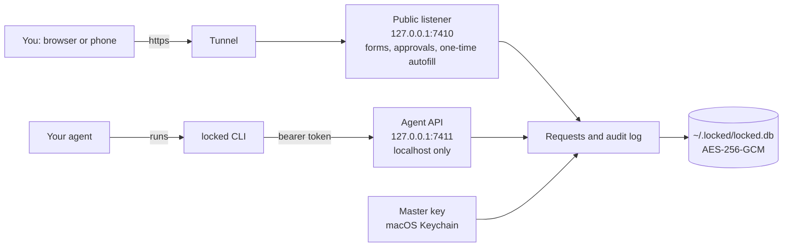
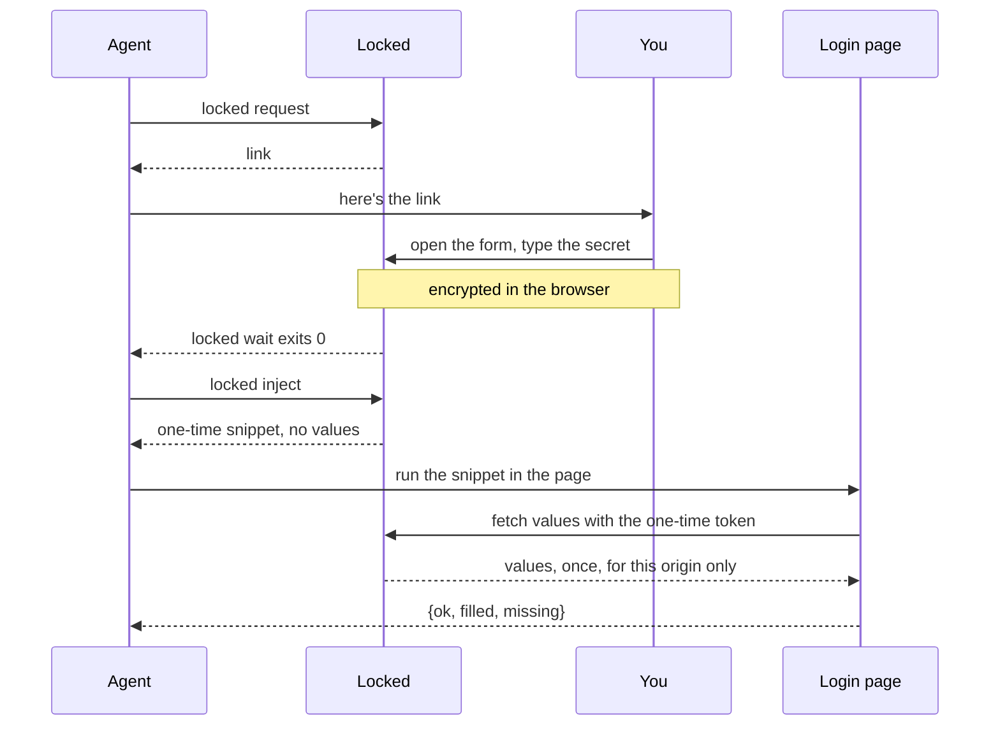

# How it works

Locked is one local process with two listeners, a SQLite file, and a tunnel in front of one of the listeners.

| Part | What it does |
|---|---|
| Public listener, `127.0.0.1:7410` | The only thing the tunnel reaches. It serves fill pages, approve pages, the one-time autofill payload, the CSP hop, the phone app and static assets. Everything else returns 404, including `/api`. Nothing here can list requests or read a secret by id. |
| Agent API, `127.0.0.1:7411` | The CLI's API, on localhost only. It needs the bearer token in `~/.locked/agent.token`, and refuses any request with an `Origin` header (browsers) or an unexpected `Host` (DNS rebinding). |
| `~/.locked/locked.db` | SQLite. Secrets are AES-256-GCM under a master key in the macOS Keychain (`locked` / `master-key`), or a 0600 file on Linux. Only SHA-256 hashes of link and use tokens are stored. |
| Tunnel | Started and watched by `locked serve`. See [tunnels](tunnels.md). |

## A secret's life

### Filling the form

The link holds a single-use token, valid for 15 minutes by default. The server keeps a P-256 key for each request. The browser encrypts the form to it (ECDH, HKDF-SHA256, AES-GCM) before posting, so the tunnel only carries ciphertext. The server then re-encrypts the values under the master key.

The form shows the site, the agent's reason, and a warning the first time a site asks.

### Autofill

`locked inject` mints a token that works once, for 60 seconds, and only from the request's site. It's CORS-bound, and the server checks `Origin`. The snippet:

- fetches the values from `/u/<token>`
- finds the inputs by `autocomplete`, type and name hints, searching open shadow roots, same-origin iframes and split OTP boxes too
- sets them in a way React and Vue pick up
- returns which fields it filled, never the values

Pages with a strict CSP `connect-src` (GitHub, Cloudflare, most banks) block that fetch. The snippet then **hops**:

1. It makes a one-off AES-GCM key and keeps it in the page's `sessionStorage`.
2. It navigates the tab to `https://<your locked>/hop#t=<token>&k=<key>&r=<this page>` and returns `reason: "hop"`.
3. The hop page fetches the values from its own origin. The server only answers if `r` is on the origin the secret is bound to.
4. The hop page encrypts the values with that key and goes straight back, with only the ciphertext in the fragment (`#locked=…`).
5. Running the same snippet again on the reloaded page decrypts the fragment, clears it and the key, and fills.

Browsers never send a fragment to a server, so neither the key nor the ciphertext reaches one. The hop page also wipes its fragment from the address bar and history as it loads. Anything typed into the page before the hop is lost, because the page reloads.

`locked copy` then cmd+V is the last resort, for forms in cross-origin iframes or closed shadow DOM where no script can reach the input. The clipboard entry is marked concealed so clipboard managers skip it, and it clears itself. The paste has to be a real keystroke, since synthetic cmd+V doesn't paste in some automated browsers.

For your own pages there's also `<script src="https://<your locked>/inject.js" data-token="…">`.

### Commands

`locked exec` runs the command with the values as environment variables (`LOCKED_<FIELD>`, or names you choose with `--env`) and redacts them from its output.

### Sealed secrets

Asking for a sealed secret's use creates an approval with its own link. The server releases nothing until you approve, and each approval covers one use. The panel and `locked get --copy` use Touch ID on the Mac instead, checked by the server.

### The Mac panel

A non-activating AppKit panel, built from `native/LockedPanel.swift`. It talks only to the localhost listener, through a one-time handle per panel, and it never takes focus. It also runs Touch ID for the server.

### Phones

- A paired phone is a passkey public key plus a Web Push subscription in the `devices` table. Pairings and shares live in memory.
- The notification carries no secret: a one-time share token, the label and the purpose. It's encrypted to the phone anyway (Web Push, RFC 8291) and signed with Locked's own VAPID key.
- Unlocking is a passkey made at pairing, with user verification required. The server checks the signature against the stored public key and releases nothing without it. For sealed secrets, that Face ID check counts as the device confirmation.
- Values travel sealed to a key the page made for that one unlock (P-256 ECDH, HKDF-SHA256, AES-GCM), so the tunnel only carries ciphertext. The page keeps them in memory and wipes them on Done, when the share ends, or after 2 minutes in the background.

## Source map

| | |
|---|---|
| `src/requests.ts` | request lifecycle |
| `src/server/` | the two listeners; `panels.ts` for panel sessions, `phone.ts` for pairing and shares |
| `src/cli.ts`, `src/client.ts` | the CLI, and starting the server when it's down |
| `src/tunnel.ts` | providers, and running them |
| `src/crypto.ts` | master key and encryption |
| `src/exec.ts` | environment and output redaction |
| `src/clipboard.ts` | concealed clipboard |
| `src/native.ts`, `native/LockedPanel.swift` | the Mac panel |
| `src/webpush.ts`, `src/webauthn.ts` | VAPID and RFC 8291; passkey checks |
| `src/resolve.ts` | names to ids |
| `web/` | pages, `autofill.js`, the phone app |
| `skill/SKILL.md` | what agents read |
