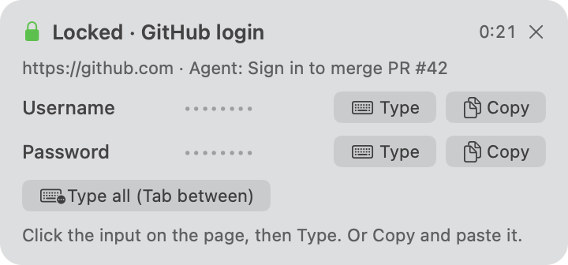

# Usage

Agents get all of this from the skill. It's here for you, and for reading what an agent is doing.

## Requesting and using a secret

```bash
locked request --label "GitHub login" --site github.com --login --reason "merge PR #42"
locked wait lk_…                      # exit 0 filled · 2 still waiting (run again) · 1 declined/expired

locked inject lk_…                    # prints a JS snippet; run it in the page; returns {ok, filled, missing}
locked inject lk_… --only password    # second page of a two-step login
locked panel lk_…                     # a panel on your Mac: click into any input, then Type (or Copy)
locked phone send lk_… --purpose "log in to the GitHub app"   # a notification on your phone: Face ID, then Copy or Show
locked copy lk_… password             # clipboard for 30 s, then cmd+V (last resort)
locked exec lk_… -- sh -c 'gh auth login --with-token <<< "$LOCKED_PASSWORD"'
locked revoke lk_…

locked creds                          # what's stored: id, level, label, site, fields, how long it's kept
locked get github                     # print a stored login in your terminal (sealed: after Touch ID)
locked get github --field password --copy   # or put one field on the clipboard, cleared after 30 s
```

Every command that takes an `lk_…` id also takes a name: the label or site of a stored secret, like `locked get "aws console"` or `locked panel github.com`. An exact label or host wins. A partial match has to be unique, otherwise Locked lists the candidates.

`--login` asks for username and password. Add other fields with `--field name[:type][?]`. The types are `username email password new-password otp apikey text textarea url number`, and `?` marks a field optional.

`--keep once|1h|24h|forever` suggests how long Locked keeps the secret, and you can change it on the form. `once` deletes it 5 minutes after the first use, so two-page logins still work.

## Running the server

```bash
locked setup      # everything at once, safe to repeat
locked doctor     # checks each part
locked restart    # after changing tunnels
locked stop
locked serve      # in the foreground, if you prefer that
```

The CLI starts the server in the background when it isn't running, with its log in `~/.locked/server.log`.

To keep it running across reboots even before the first command, use pm2 from a normal terminal:

```bash
pm2 start ecosystem.config.cjs && pm2 save
```

Start the pm2 daemon from a terminal rather than from inside a sandboxed tool: a daemon that can't reach macOS services can't read the Keychain, and Locked won't start under it.

## Agents

```bash
locked install-skill                  # the agents found on this machine
locked install-skill --agent claude   # ~/.claude/skills (or $CLAUDE_CONFIG_DIR/skills)
locked install-skill --agent codex    # ~/.agents/skills
locked install-skill --dir <folder>   # anything else that reads Agent Skills
locked skill                          # print it, for AGENTS.md or similar
```

## Sealed secrets

`--level sealed` is for the high-stakes ones: bank, email, primary accounts, keys that can spend money.

- The agent can never print one. `locked get` prints it only into a real terminal, not a pipe or a tool's output, after Touch ID.
- Every `inject`, `exec` or `copy` first prints an approval link (`/a/…`). Nothing happens until you tap Approve.
- `locked panel` and `locked get --copy` ask for Touch ID on the Mac instead, or your login password if there's no Touch ID. The server runs the check, so a script can't skip it.
- Each approval or Touch ID covers one use.

## Native panel (macOS)

`locked panel <id>` shows a small floating panel at the top right: the secret's label and site, why the agent wants it, and **Type** and **Copy** for each field, plus **Type all**. Click into the input first, in any app, then click Type. The panel never takes focus away from that input.



- Values reach the panel only on your first click, through a one-time handle on the localhost listener. The CLI that asked for the panel never sees them.
- It closes after `--timeout` (120 s by default, 10 minutes at most) and wipes the values.
- **Type** needs Accessibility permission once: System Settings → Privacy & Security → Accessibility → Locked. Copy works without it.
- The app is built from `native/LockedPanel.swift` with the Xcode Command Line Tools on first use, into `~/.locked/LockedPanel.app`. It's rebuilt only when the source changes. After a rebuild, turn Locked off and on again in Accessibility.

## Your phone

Pair it once. This needs a tunnel with a stable address (see [tunnels](tunnels.md)).

```bash
locked phone pair --name "iPhone"     # prints a link and a code; works once, for 10 minutes
```

- **iPhone:** open the link in Safari, tap Share → Add to Home Screen, and open Locked from the Home Screen (iOS only lets Home Screen web apps show notifications). Enter the code, tap Allow notifications, then Create passkey.
- **Android:** open the link in Chrome, allow notifications, create the passkey.

After that, `locked phone send <id> --purpose "…"` puts a notification on the phone. Tap it and unlock with Face ID, then **Copy** or **Show** each field. **Done** wipes it. The share closes after `--timeout` (10 minutes by default, 1 hour at most).

`locked phone list` shows paired phones, `locked phone test` sends a test notification, and `locked phone remove dv_…` unpairs one.

## Audit

`locked audit [<id>]` lists everything that happened to a secret: created, opened, filled, used, by which route.
